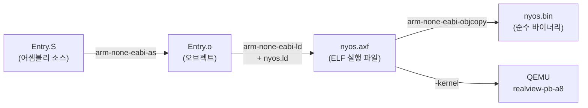

# 3장. 일단 시작하기

- [ch03의 코드](https://github.com/na495/nyos/tree/ch03)
- [ch03에서 추가된 내용](https://github.com/na495/nyos/compare/ch02...ch03)

## Keyword

1. 리셋 벡터 : 전원이 켜지면 CPU가 가장 먼저 실행하는 메모리 주소 (`0x00000000`)
2. 링커 스크립트 (`nyos.ld`) : 오브젝트 파일의 각 섹션을 메모리 어디에 배치할지 정하는 설정 파일
3. Makefile : 빌드 명령을 자동화하는 스크립트
   - `make`, `make run`, `make debug`, `make gdb`
4. 데이터시트 : 하드웨어 레지스터의 주소와 의미가 적힌 공식 문서

빌드 흐름 :



파일 구조 :

```text
nyos/
├── Makefile          # 빌드 자동화
├── nyos.ld           # 링커 스크립트
├── boot/
│   └── Entry.S       # 리셋 벡터 위치에 놓는 부팅 코드
└── build/            # make 결과물
    ├── Entry.o
    ├── nyos.axf
    └── nyos.bin
```

## 리셋 벡터 (Entry.S)

ARM 코어는 전원이 켜지면 메모리 주소 `0x00000000`에서 32bits 명령어를 읽어 실행한다.

- 이 위치에 부팅 코드가 있어야 펌웨어가 동작함
- 이후 리셋벡터 내에 익셉션 벡터 테이블(리셋, 인터럽트 같은 예외 상황별 진입점을 모음)을 구성함

Entry.S :

```armasm
.text                           @ 이후 코드를 실행 코드 섹션(.text)에 배치
	.code 32                    @ 32비트 ARM 명령어로 어셈블
	.global vector_start        @ 심볼 공개 → 링커가 참조 가능
	.global vector_end

	vector_start:               @ 코드 시작 레이블 → 링커가 0번지에 배치
		LDR R0, =0x10000000     @ R0에 SYS_ID 레지스터 주소 저장
		LDR R1, [R0]            @ R0이 가리키는 주소의 값을 읽어 R1에 저장
	vector_end:
		.space 1024, 0          @ 1024바이트를 0으로 채움
.end                            @ 소스 파일의 끝
```

terminal :

```shell-session
$ arm-none-eabi-as -march=armv7-a -mcpu=cortex-a8 -o Entry.o ./Entry.S   # 어셈블 : .S → .o
$ arm-none-eabi-objcopy -O binary Entry.o Entry.bin                      # 순수 바이너리 추출: .o → .bin
$ hexdump Entry.bin                                                      # 바이너리를 16진수로 출력해 기계어 확인
```

## 실행 파일 만들기 (nyos.ld)

`.o`는 아직 메모리 어디에 놓일지 정해지지 않았다.
그래서 링커 스크립트로 배치를 지정해 ELF 실행 파일을 만든다.

nyos.ld :

```armasm
ENTRY(vector_start)             /* 실행 시작 심볼 지정 */
SECTIONS
{
	. = 0x0;                    /* 배치 시작 주소를 0번지로 설정 (리셋 벡터) */
	.text :                     /* 코드 섹션 */
	{
		*(vector_start)         /* vector_start를 맨 앞에 배치 */
		*(.text .rodata)        /* 나머지 코드, 읽기 전용 데이터 */
	}
	.data :                     /* 초기값 있는 전역 변수 */
	{
		*(.data)
	}
	.bss :                      /* 초기값 없는 전역 변수 */
	{
		*(.bss)
	}
}
```


1. 링크 : `.o` → `.axf` (ELF)
```shell-session
$ arm-none-eabi-ld -n -T ./nyos.ld -nostdlib -o nyos.axf boot/Entry.o
```
	- `-n` : 섹션 정렬 패딩 최소화
	- `-T` : 링커 스크립트 지정
	- `-nostdlib` : 표준 라이브러리 제외 (베어메탈)
<br><br>
2. 역어셈블 : `vector_start`가 `0x00000000`에 있는지 확인
```shell-session
$ arm-none-eabi-objdump -D nyos.axf
00000000 <vector_start>:
   0:   ...
```

## 빌드 자동화 (Makefile)

어셈블 → 링크 → 바이너리 추출 → 실행 과정을 매번 입력하지 않도록 Makefile로 묶는다.

Makefile :

```Makefiles
# 타깃 아키텍처, CPU
ARCH = armv7-a
MCPU = cortex-a8

# 크로스 툴체인
AS = arm-none-eabi-as
LD = arm-none-eabi-ld
OC = arm-none-eabi-objcopy

LINKER_SCRIPT = ./nyos.ld
ASM_SRCS = $(wildcard boot/*.S)                          # boot/ 안의 모든 .S 목록
ASM_OBJS = $(patsubst boot/%.S, build/%.o, $(ASM_SRCS))  # boot/xxx.S → build/xxx.o

nyos = build/nyos.axf
nyos_bin = build/nyos.bin

.PHONY: all clean run debug gdb     # 파일이 아닌 명령 이름 → 항상 실행

all: $(nyos)                        # make 기본 타깃

clean:
	@rm -fr build                   # @ : 명령어 자체는 출력하지 않음

run: $(nyos)                        # QEMU 바로 실행
	qemu-system-arm -M realview-pb-a8 -kernel $(nyos)

debug: $(nyos)                      # CPU 정지 + GDB 대기 상태로 실행
	qemu-system-arm -M realview-pb-a8 -kernel $(nyos) -S -gdb tcp::1234,ipv4

gdb:                                # GDB 실행
	arm-none-eabi-gdb

$(nyos): $(ASM_OBJS) $(LINKER_SCRIPT)   # .o나 링커 스크립트가 바뀌면 다시 링크
	$(LD) -n -T $(LINKER_SCRIPT) -nostdlib -o $(nyos) $(ASM_OBJS)
	$(OC) -O binary $(nyos) $(nyos_bin)

build/%.o: boot/%.S                 # .S 하나 → .o 하나로 어셈블
	mkdir -p $(shell dirname $@)    # 출력 폴더가 없으면 생성
	$(AS) -march=$(ARCH) -mcpu=$(MCPU) -g -o $@ $<
	# $@ : 타깃 파일 (build/Entry.o)
	# $< : 첫 번째 의존 파일 (boot/Entry.S)
	# -g : 디버깅 심볼(원래 소스코드 연결) 포함
```

## 데이터시트 분석


펌웨어에서 하드웨어를 다루는 것은 레지스터 주소에 값을 읽고 쓰는 과정이므로 레지스터에 대한 이해가 필요하다.

- RealView PB-A8 SYS_ID 레지스터(`0x10000000`) : 보드 종류, 버전 등 식별 정보
- 부팅 코드에서 이 주소의 값을 읽어 범용 레지스터에 저장
- GDB로 `stepi` 실행 후 `info registers`로 값 확인


## Source
[RealView PB-A8 User Guide](notes/files/DUI0417D_realview_pb_a8_ug.pdf ':ignore :target=_blank')